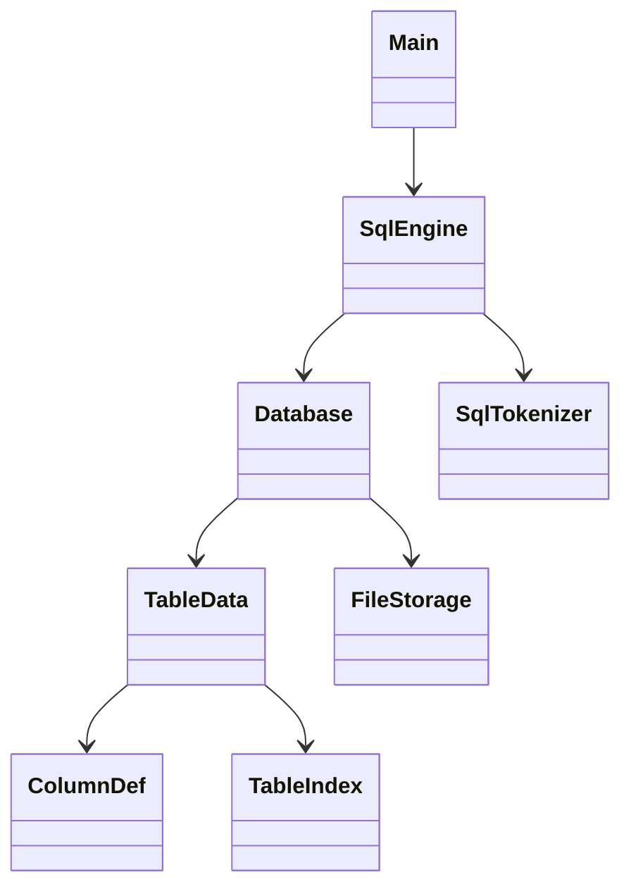
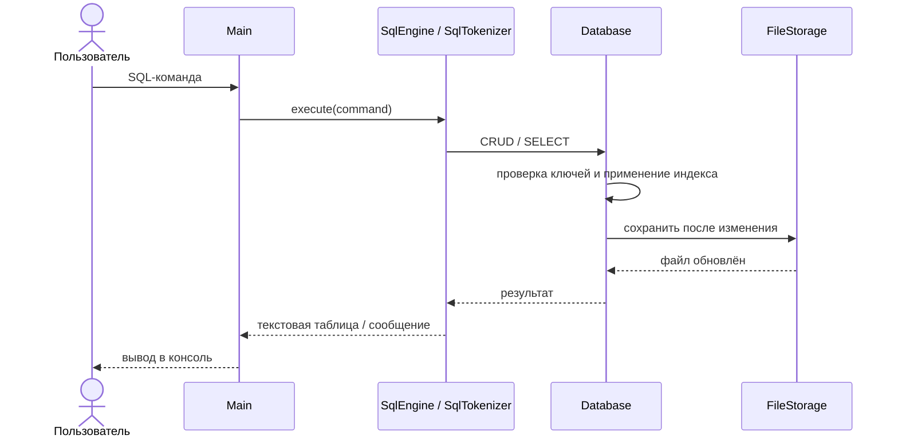

# Упрощённая СУБД на Java

Консольная учебная СУБД. Она хранит таблицы `owners` и `cars` в бинарном файле, восстанавливает их при запуске и поддерживает небольшой SQL-подобный язык. Таблицы связаны внешним ключом `cars.owner_id → owners.id`.

## Требования

- JDK 8 или новее (проект рассчитан на Java 8).
- Windows: откройте проект в IntelliJ IDEA либо запустите `run.bat`.
- Сторонние библиотеки и установленная СУБД не нужны.

## Запуск

### IntelliJ IDEA

Откройте папку проекта. В `src/main/java/` найдите `Main.java` и запустите метод `main` . Если IDE попросит JDK, выберите установленный JDK 8+.

### Windows PowerShell

Из папки проекта выполните `.\run.bat`. Скрипт скомпилирует исходники в `out` и запустит программу. Данные сохраняются в `data/database.bin` относительно текущей папки.

## Таблицы по умолчанию

| Таблица | Столбцы |
| --- | --- |
| `owners` | `id INT PRIMARY KEY`, `name STRING`, `age INT`, `rating DOUBLE`, `registered DATE`, `active BOOLEAN` |
| `cars` | `id INT PRIMARY KEY`, `owner_id INT REFERENCES owners(id)`, `brand STRING`, `price DOUBLE`, `year INT`, `available BOOLEAN` |

Поддерживаемые типы: `INT`, `DOUBLE`, `STRING`, `DATE` (ISO `YYYY-MM-DD`), `BOOLEAN` (`TRUE`/`FALSE`). Строки заключаются в одинарные кавычки; одинарную кавычку внутри строки удваивают.
При INSERT можно указать только часть столбцов; остальные значения будут пустыми (`null`). Первичный ключ обязателен.

## Примеры команд

```sql
INSERT INTO owners VALUES (1, 'Анна', 30, 4.8, '2026-01-10', TRUE);
INSERT INTO owners (id, name, age, rating, registered, active)
VALUES (2, 'Иван', 35, 4.5, '2025-09-01', TRUE);
INSERT INTO cars VALUES (1, 1, 'Toyota', 25000.0, 2020, TRUE);
INSERT INTO cars VALUES (2, 2, 'BMW', 32000.0, 2022, TRUE);
SELECT * FROM cars;
SELECT brand, price FROM cars WHERE price > 20000;
UPDATE cars SET price = 30000 WHERE id = 2;
DELETE FROM cars WHERE brand = 'Toyota';
CREATE INDEX idx_cars_brand ON cars (brand);
SELECT * FROM cars WHERE brand = 'BMW';
CREATE TABLE notes (id INT PRIMARY KEY, text STRING, created DATE);
DROP TABLE notes;
HELP;
EXIT;
```

Можно вставлять несколько строк одним `INSERT`, разделяя наборы значений запятыми. В `WHERE` поддерживаются условия `=`, `!=`, `<>`, `>`, `>=`, `<`, `<=`, соединённые через `AND`. `UPDATE` принимает несколько присваиваний через запятую.

## Архитектура



Последовательность запроса:



### Основные классы

- `Main` — консольный цикл команд.
- `SqlTokenizer` — разбивает SQL на токены, сохраняя строки в кавычках.
- `SqlEngine` — разбирает команды и выполняет их.
- `Database` — таблицы, проверка первичных и внешних ключей, поиск и управление индексами.
- `TableData`, `ColumnDef`, `TableIndex` — схема, строки и индекс.
- `FileStorage` — сериализация и восстановление состояния из файла; сохранение выполняется через временный файл и замену.

## Индексы и замер производительности

Индекс хранит соответствие `значение столбца → множество первичных ключей`. Он записывается в тот же файл, что и таблицы. При `SELECT` условие по индексированному столбцу даёт набор кандидатов по индексу, после чего условия всё равно проверяются для каждой найденной строки. Изменения строк обновляют индекс.

Для воспроизводимого сравнения выполните, например:

```sql
BENCHMARK cars brand 'Toyota' 10000;
```

Команда сообщает длительность полного сканирования и поиска в наносекундах. Замеры ниже сняты на компьютере при 3 строках и 10000 повторах. Для замера без индекса второй путь также выполнял полный перебор, потому что индекс ещё не был создан. При сравнении с индексом на таком небольшом наборе индексный поиск оказался медленнее; это демонстрирует накладные расходы индекса, но не позволяет оценить его пользу на большой таблице.

| Строк в `benchmark_cars` | Повторы | Индекс | Полный перебор, нс | Поиск по индексу, нс |
| --- | --- | --- | --- | --- |
| 3 | 10000 | нет | 37 386 700 | 41 080 700 |
| 3 | 10000 | `brand` | 15 580 100 | 27 671 800  |

## Тестирование и выводы

Проверены вставка и выборка записей, отказ при повторном первичном ключе и неверном внешнем ключе, обновление и удаление строки, создание и удаление таблицы, создание индекса и выборка по индексированному столбцу. Выборка после создания индекса вернула обе записи с брендом Toyota.

В замере на 3 строках поиск с индексом занял 27 671 800 нс, а полный перебор — 15 580 100 нс. На таком маленьком наборе индекс оказался примерно в 1,8 раза медленнее из-за накладных расходов. 

Сохранение проверено перезапуском программы: после повторного запуска запрос `SELECT * FROM owners WHERE id = 9001;` вернул ранее добавленную запись.

## Ответственность участников

- **Гусева Алина — хранение данных и модель таблиц:** `Database`, `FileStorage`, `TableData`, `ColumnDef`, `ColumnType`, `TableIndex`; первичные и внешние ключи, индексы и сохранение базы.
- **Исмаилова Эльвира — SQL и интерфейс:** `SqlTokenizer`, `SqlEngine`, `Main`, запуск через `run.bat`; примеры команд, архитектурные схемы и пользовательская документация.

## Источники

- Java SE API, `ObjectOutputStream`: [https://docs.oracle.com/javase/8/docs/api/java/io/ObjectOutputStream.html](https://docs.oracle.com/javase/8/docs/api/java/io/ObjectOutputStream.html)
- Java SE API, `Serializable`: [https://docs.oracle.com/javase/8/docs/api/java/io/Serializable.html](https://docs.oracle.com/javase/8/docs/api/java/io/Serializable.html)